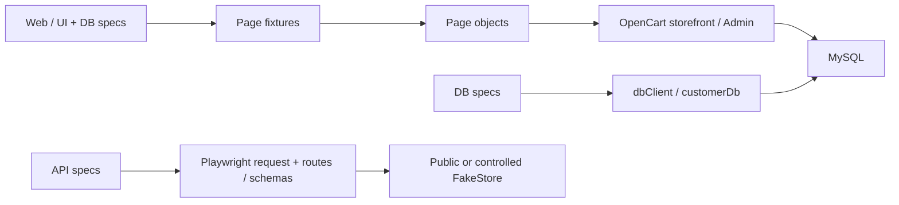

# Architecture and code map

This repository is a Playwright test harness for two separate targets: the
OpenCart storefront/Admin with MySQL, and the FakeStore HTTP API. The controlled
FakeStore service used by container runs is also maintained here. OpenCart API
testing is not implemented by `tests/api`.

[Documentation index](README.md) · [Testing](TESTING.md) · [Configuration](CONFIGURATION.md)

DB journeys drive the browser through the web path and verify saved state through
the SQL path. The connection-only spec uses only SQL; API specs use only HTTP.

## Repository map

| Path | Responsibility |
| --- | --- |
| [`playwright.config.ts`](../playwright.config.ts) | Test discovery, browser projects, parallelism, retries, browser options and reporters. |
| [`package.json`](../package.json), [`package-lock.json`](../package-lock.json), [`tsconfig.json`](../tsconfig.json) | Declared dependencies, resolved dependency versions and TypeScript scope. |
| [`tests/web/`](../tests/web/README.md) | Storefront account, login and shopping scenarios. |
| [`tests/api/`](../tests/api/README.md) | FakeStore authentication, products, users and carts, including schemas and simulated CRUD workflows. |
| [`tests/db/`](../tests/db/README.md) | OpenCart UI/MySQL consistency, customer lifecycle/validation and the live SQL connection-error check. |
| [`pages/`](../pages/) | Storefront, account and Admin page objects; UI locators, actions and readers. |
| [`fixtures/pageFixtures.ts`](../fixtures/pageFixtures.ts) | Test-scoped page objects sharing Playwright's `page` and browser context. |
| [`fixtures/dbFixtures.ts`](../fixtures/dbFixtures.ts) | Generated customer data, registration setup and scoped database teardown. |
| [`api/endpoints/routes.ts`](../api/endpoints/routes.ts), [`api/schemas/`](../api/schemas/) | FakeStore route templates and product/user/cart JSON schemas. |
| [`testdata/`](../testdata/) | External login cases and deterministic FakeStore payloads/boundaries. |
| [`utils/`](../utils/) | Data readers/generation, configuration access, price conversion, API assertions and SQL helpers. |
| [`docker/`](../docker/README.md), [`docker-compose.yml`](../docker-compose.yml) | OpenCart/MySQL runtime, OpenCart startup helpers and application image sources. |
| [`docker-compose.ci.yml`](../docker-compose.ci.yml), [`docker-compose.test.yml`](../docker-compose.test.yml) | Controlled FakeStore/MongoDB services and the opt-in Playwright runner. |
| [`scripts/ci/`](../scripts/ci/), [GitHub workflow](../.github/workflows/playwright.yml) | Suite selection, environment validation, Docker orchestration and CI execution/artifact upload. |
| [`docs/`](README.md) | Maintained guidance by topic. [`prompts/`](../prompts/README.md) and [`docs/superpowers/plans/`](superpowers/plans/) record scenario requests and implementation plans. |

## Web fixture and page-object flow

Web specs import `test` and `expect` from
[`pageFixtures.ts`](../fixtures/pageFixtures.ts), then request named page objects
in the test callback. Fixtures are test-scoped and created when requested.
Every object wraps the same Playwright `page`; a page-object constructor does not
create a browser or navigate. The `homePage` fixture opens `WEB_APP_URL` before
yielding its object. Other page fixtures only construct their wrappers.

The page objects cover home/search/product/cart, registration/login/logout,
account/profile/password, and Admin login/customer management. They keep
locators private and expose actions and value/visibility readers. Known
navigation methods can return the destination page-object type. Login and
registration submission return `void`; specs check the actual result with
URL assertions and `expect.poll()` around page-object readers. Scenario
assertions and scenario `test.step()` descriptions belong in specs; fixtures may
assert and describe their own setup/teardown prerequisites.

Playwright supplies an isolated context for each test. The fixture module also
closes the page/context after each test. Browser isolation does not roll back
server data: ordinary web registration and shopping journeys leave their newly
registered customers in OpenCart. The DB suite adds explicit SQL cleanup.

## Data and configuration flow

- [`Helper`](../utils/helper.ts) reads configured customer/Admin credentials and
  product expectations, and converts formatted prices for assertions.
- [`RandomDataUtil`](../utils/dataGenerator.ts) generates customer details with a
  UUID email and field-length limits. It also exposes general Faker payload
  generators; current FakeStore specs use deterministic JSON instead.
- [`DataProvider`](../utils/DataReader.ts) reads JSON, CSV and the first Excel
  worksheet. The current data-driven login spec reads
  `opencart_logindata.json`; the adjacent CSV/XLSX files are not selected by that
  spec. Its successful row resolves `APP_EMAIL`/`APP_PASSWORD` at execution;
  rejected rows use their dataset inputs.
- [`fakestoreTestSupport.ts`](../utils/fakestoreTestSupport.ts) loads API
  configuration and `fakestore_api_data.json`, compiles schemas with AJV, and
  provides shared schema/generated-ID assertions. Required API IDs, limit and
  dates are read while importing the module, including during discovery.

The Playwright config and several helpers load the ignored root `.env` for
host-side runs. Container orchestration supplies environment variables directly.
Variable meanings, precedence and host/container addresses belong in
[configuration guidance](CONFIGURATION.md). Keep credentials in the runtime
environment; use `testdata/` for non-secret inputs and expected results.

## API request flow

API specs import Playwright's base `test` and use its `request` fixture, without
requesting a browser page. Each spec sets `baseURL` from `apiConfig`, uses
[`Routes`](../api/endpoints/routes.ts) for paths, sends payloads from
[`fakestore_api_data.json`](../testdata/fakestore_api_data.json), and checks
responses in the spec or shared API assertion helpers.

Dependent create/update/delete steps stay inside one workflow test; standalone
tests use configured existing IDs. FakeStore writes are simulated, so a returned
created ID does not imply a persistent resource or a new login account. Public
service runs and the controlled MongoDB-backed compatibility service share the
suite but have different availability and infrastructure. Their contract details
belong in the [API suite README](../tests/api/README.md) and
[controlled service README](../docker/fakestore/README.md).

## Database verification flow

DB lifecycle and validation specs extend the web fixtures through
[`dbFixtures.ts`](../fixtures/dbFixtures.ts). `customerData` checks SQL
connectivity, generates unique details and tears down that customer's rows.
`registeredCustomer` registers through the storefront and captures the saved
customer ID/fields before yielding to the scenario. SQL verifies the application's
write; fixtures do not insert the expected customer row directly.

[`dbClient.ts`](../utils/dbClient.ts) opens a MySQL connection for each query,
uses `execute(sql, params)`, and closes the connection in `finally`.
[`customerDb.ts`](../utils/customerDb.ts) owns exact-email lookups and customer
cleanup. Cleanup uses the captured ID to handle an email change or Admin deletion
and removes the defined related rows. There is no transaction around a test.

`customer-registration.spec.ts` uses web fixtures with its own preflight and
`finally` cleanup. `db-client.spec.ts` uses the base Playwright test and real
MySQL without a browser. See the [DB suite README](../tests/db/README.md) for
prerequisites, coverage and cleanup limits.

## Where changes belong

| Change | Place it here |
| --- | --- |
| New behavior check | The relevant `tests/web`, `tests/api` or `tests/db` spec; update that suite's README. |
| Reusable locator/action/reader | An existing or new `pages/*.ts` class; expose new page objects in `pageFixtures.ts`. |
| Repeated setup/teardown | A test-scoped fixture in `fixtures/`; DB customer lifecycle belongs in `dbFixtures.ts`/`customerDb.ts`. |
| Reusable synthetic inputs/boundaries | `testdata/`; retain the distinction between generated unique accounts and configured reusable accounts. |
| API path or schema contract | `api/endpoints/routes.ts` or `api/schemas/`; shared checks belong in `fakestoreTestSupport.ts`. |
| SQL connection behavior | `utils/dbClient.ts`; OpenCart customer queries/cleanup belong in `utils/customerDb.ts`. |
| Service startup or test-runner behavior | The relevant Docker/Compose file or `scripts/ci/` helper and its owning operational guide. |

Add the appropriate tags to new scenarios. The current config discovers all
`tests/` files for each browser project and enables parallel execution. Keep
scenario state within one test or test-scoped fixtures; a project name does not
make a request-only test browser-specific.

## Sources of truth

| Question | Owning source and guide |
| --- | --- |
| What executes and what does it assert? | Spec files and their fixture/helper implementations; suite READMEs explain coverage. |
| How are suites selected and run? | `scripts/ci/run-tests.sh` and `playwright.config.ts`; [testing guide](TESTING.md). The `test:*` selectors are shell-runner arguments, not npm scripts. |
| Which configuration inputs are used? | Consuming source, [`.env.example`](../.env.example) and [configuration guide](CONFIGURATION.md). |
| How are containers/CI wired? | Compose files, Dockerfiles, orchestration scripts and workflow; [Docker guide](../docker/README.md) and [CI guide](CI.md). |
| Which report files are produced/uploaded? | `playwright.config.ts`, workflow and report helpers; [reporting guide](TESTING.md#docker-ci-and-reports). `CustomReporter.ts` is present but disabled in the current config. |
| How should contributors and agents work? | [contributor guide](../CONTRIBUTING.md) and [`AGENTS.md`](../AGENTS.md). |

Update the owning guide when behavior changes. Prompts, plans and dated run
results provide context; verify current implementation and runtime state before
using them as evidence of supported behavior or a passing suite.
